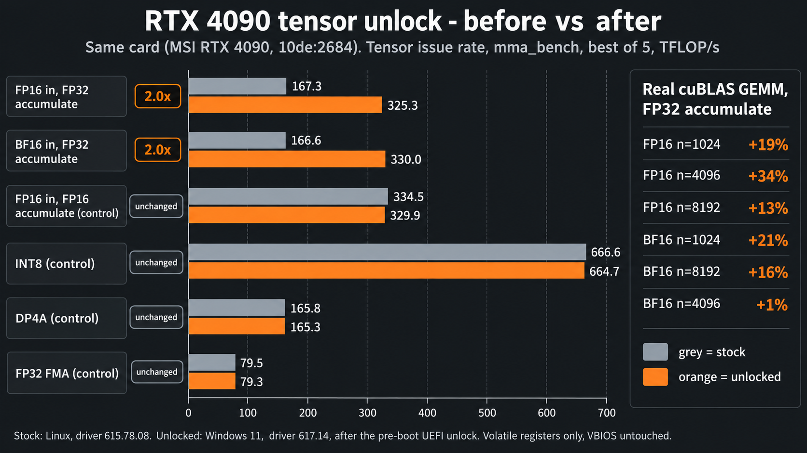

# RTX 4090 tensor unlock for Windows (UEFI)

[Zagitta/gpu-unlock](https://github.com/Zagitta/gpu-unlock) is a Linux module that unlocks the full FP16/BF16 tensor rate with FP32 accumulate on RTX 30-series cards. The forks by elias-gaeros and [JustAResearcher/gpu-unlock-ada](https://github.com/JustAResearcher/gpu-unlock-ada) brought it to Ada on Linux, and TOTORONG wrote a Windows UEFI app for one RTX 4080. This repo adapts that work to any RTX 4090 (`10de:2684`) and runs it before Windows starts.

The card ignores these register writes from the host. They only go through NVIDIA's signed firmware chain (Booter, GSP-RM and a payload), so the app needs five files next to it, 84 MB in total: four NVIDIA 610.43.03 firmware files and one generated 64 KB payload image. [NVIDIA-FILES.md](win4090/NVIDIA-FILES.md) says where each one comes from.

On my PC, FP16 and BF16 with FP32 accumulate went from 167 to about 330 TFLOP/s in Windows. Real cuBLAS matrix multiplications gained up to 34% (measured on Linux); the doubled issue rate is the ceiling.



## What it speeds up

The unlock speeds up any program that multiplies FP16 or BF16 matrices on the tensor cores with FP32 accumulation. PyTorch does that by default for FP16 and BF16, so most GPU work in PyTorch benefits:

- training and fine-tuning in mixed precision, including LoRA;
- image and video generation models running in FP16 or BF16;
- speech recognition and text-to-speech models in FP16 or BF16;
- LLM prompt processing and batched inference. Generating tokens for a single chat is limited by memory bandwidth and barely changes;
- outside AI, mixed-precision linear solvers that factor a matrix in FP16 on the tensor cores and refine the answer to FP64 accuracy (cuSOLVER's iterative refinement solvers), and signal processing such as the radio-astronomy Tensor-Core Correlator.

It does nothing for games, for FP16 math with FP16 accumulation, INT8, or ordinary FP32 math on the CUDA cores. Crypto mining does not gain either: hashing is integer work.

## How to use

1. If BitLocker is on, suspend it first, as [Secure Boot and BitLocker](#secure-boot-and-bitlocker) below explains. Then turn Secure Boot off in the firmware setup. The app is unsigned.
2. Download `rtx4090-unlock.zip` from this repo's [Releases](https://github.com/MarvinFS/rtx4090-uefi/releases) and unzip it. It holds the app, the five firmware files and the install, check and uninstall scripts.
3. Double-click `Install.cmd`. It shows its plan, asks Y/N, copies the files and adds a firmware boot entry "RTX 4090 unlock" ahead of Windows Boot Manager. The files go to the GPU4090 partition an earlier install left behind, else to the EFI partition, else to a new 128 MB FAT32 partition in free space. If there is no room, it changes nothing and tells you how much to shrink C: by. You can shrink C: in Disk Management while Windows runs, without a restart, and then run `Install.cmd` again.
4. Restart. You get a 3 second countdown, the screen freezes for a moment during the unlock, then Windows starts. Esc during the countdown opens a menu: 1 unlocks and starts Windows, 2 starts Windows without the unlock.
5. In Windows, run `C:\ProgramData\Gpu4090Unlock\Check.cmd`. It reads the app's boot log and can run a one-minute benchmark that shows whether this session is unlocked.

If Windows does not come up, power off, open the firmware boot menu (F11 on many boards) and pick Windows Boot Manager. That path never runs the app.

`Uninstall.cmd` removes the boot entry and the app's files. The GPU4090 partition stays, empty, and the next `Install.cmd` reuses it. To get the space back, delete that partition in Disk Management and extend C: into the freed space.

If something here does not fit your PC, ask your AI agent to help and adapt it to your hardware. All install options are in [Install options, checks and limits](#install-options-checks-and-limits) below. Developer notes and tests: [win4090/README.md](https://github.com/MarvinFS/rtx4090-uefi/blob/main/win4090/README.md).

## Secure Boot and BitLocker

The app is not signed, so it runs only with Secure Boot off. I do not sign it, but you can. Create your own signing key and sign `UNLOCK4090.EFI` with it (`sbsign` on Linux, `signtool` on Windows). Then enroll your certificate in the Secure Boot db in the firmware setup's key management, next to Microsoft's certificates. Some AMI-based firmware can instead enroll the hash of one EFI file with "Enroll EFI Image". Keep Microsoft's certificates in db, or Windows stops booting. Today the installer refuses to run with Secure Boot on, and the app skips the unlock when it sees Secure Boot on, so this route also means changing those two checks.

BitLocker asks for its recovery key when the software that runs before Windows changes. With Secure Boot on, BitLocker usually seals its key to PCRs 7 and 11. PCR 7 records the Secure Boot state, so turning Secure Boot off is already such a change. With Secure Boot off, BitLocker seals its key to PCRs 0, 2, 4 and 11. PCR 4 records every boot application, so adding this entry, an extra program before Windows Boot Manager, changes the measurements again. Suspend BitLocker before you change Secure Boot, with `Suspend-BitLocker -MountPoint C: -RebootCount 3`. The count covers the restart into the firmware setup, the restart after the install, and one spare. Otherwise, have the recovery key ready. Any other change to that chain does the same: starting Windows Boot Manager directly from the firmware boot menu, removing the entry, or installing a different build of the app. With Secure Boot on and a self-signed app, BitLocker may not be able to use its Secure Boot binding (PCR 7) and falls back to PCRs 0, 2, 4 and 11. `manage-bde -protectors -get C:` shows which profile your PC uses.

## Building the package

The release zip comes from `win4090/make-package.sh out`, run on Linux with zig 0.14.1 and Python 3. It takes the five firmware files from the `gpu-unlock-firmware` package of gpu-unlock-ada v1.1.1, which installs them in `/usr/lib/firmware/gpu-unlock/610.43.03/`. That package's build downloads NVIDIA's open kernel module source from download.nvidia.com and decodes three files from it. It takes `gsp_ga10x.bin` unchanged from CachyOS's `nvidia-utils` 610.43.03 package and generates the payload image. [NVIDIA-FILES.md](win4090/NVIDIA-FILES.md) lists the URLs and checksums, and `make-package.sh` stops if a file does not match them. The zip gets a copy of this README. `tools/mma_bench.exe` is built on Windows with `tools/build-mma_bench.bat`.

## Status

It works on my system (MSI RTX 4090, ASRock X870E Taichi, Windows 11, NVIDIA 617.14) as a UEFI boot entry, with the manual fallback above. That is the only PC it has run on.

The app rewrites volatile GPU registers on every boot, and a full power-off returns the card to stock. Making it permanent would mean changing the card's signed firmware, and I did not bother.

Untested: Fast Startup, resume from hibernation, warm restarts, driver and BIOS updates.

The code is GPL-2.0-only (`LICENSE`). The NVIDIA files are only in the release zip, unmodified, and stay under NVIDIA's license. Upstream credits and notices: [THIRD_PARTY_NOTICES.md](win4090/THIRD_PARTY_NOTICES.md) and [UPSTREAM-WINDOWS-NOTICES.md](win4090/UPSTREAM-WINDOWS-NOTICES.md).

## Install options, checks and limits

You need UEFI boot, Secure Boot off, exactly one RTX 4090 in the PC, and about 85 MB free on one FAT32 volume. The installer prints the exact figure. The app itself is under 100 KB. Nearly all the space goes to NVIDIA's 84 MB GSP firmware image: the transaction hands it whole, with its signature, to NVIDIA's signed Booter, as the normal driver does. No smaller variant is known to work, and the file does not compress well (xz takes it from 84 MB to 70 MB).

From an elevated PowerShell in the unzipped folder, the installer works the same as `Install.cmd`:

```powershell
.\Install-Gpu4090Unlock.ps1            # inspects this PC and prints the plan; changes nothing
.\Install-Gpu4090Unlock.ps1 -Apply     # does it
```

`-Target Auto` (the default) picks the place in the order from step 3. The EFI partition qualifies only if 32 MB of headroom is left over, so Windows servicing keeps working. Many ESPs of 260 MB or more qualify, and a 100 MB ESP usually does not. A new partition is at least 128 MB, or 272 MB on disks with 4K sectors, where FAT32 needs 260 MB or more. Auto never creates a second GPU4090 partition. If the one an earlier install left is too small, the installer says so. Delete it in Disk Management and run the installer again. To pick the place yourself, use one of these:

- `-Target Reuse`: the GPU4090 partition an earlier install left.
- `-Target Esp`: the EFI partition.
- `-Target FreeSpace`: a new partition in existing unallocated space.
- `-Target NewPartition -NewPartitionMB <n>`: the script shrinks C: itself. It never does that on its own.
- `-Target Volume -VolumeLetter E:`: any existing FAT32 volume. A USB stick works only while it stays plugged in.

If Windows cannot shrink C: far enough because of unmovable files, run `powercfg /h off`, restart, and try again. `-Variant Manual` installs the build whose countdown ends in plain Windows. In that build you press U to unlock.

The installer checks every file against `SHA256SUMS` once, to catch a damaged download. It copies the app to `\EFI\GPU4090\` and the firmware files to `\GPU4090-ASSETS\`, keeps files that are already there with the same SHA-256, and reads the copies back. Then it adds the boot entry with `bcdedit` and reads the firmware boot order back to confirm the entry is first. Windows Boot Manager stays in the list. The GPU4090 partition has no drive letter, because the boot entry does not need one and Explorer would warn about its low free space. The tools mount it when they need it. `Check.cmd`, `Uninstall.cmd` and their scripts stay in `C:\ProgramData\Gpu4090Unlock\`, so you do not need the package folder afterwards.

`Check.cmd` changes nothing. It reports the install record and whether "RTX 4090 unlock" is still first in the firmware boot order. BIOS and Windows updates can reorder it, and the check then prints the fix. Next come the files on the partition, compared against `SHA256SUMS`, and the app's newest boot log, `\GPU4090-UNLOCK\RUNnnnn.TXT`, which should be from this boot and contain `TRANSACTION OK` and `POST-GOP SS0=0x88888888 SS1=0x8`. The report ends with `nvidia-smi` and any NVIDIA driver errors in the System event log since boot. If you say yes, the check then runs a one-minute measurement with `tools\mma_bench.exe`. Unlocked, FP16 and BF16 with FP32 accumulate run at the FP16-accumulate rate, about 330 TFLOP/s. Stock, they run at half of it, so one run needs no earlier baseline. Each run is saved as `C:\ProgramData\Gpu4090Unlock\check-<time>.log`. For real workloads, `benchmark.py` and `compare.py` compare cuBLAS matrix multiplications before and after. They need Python and PyTorch with CUDA.

From an elevated PowerShell, `.\Uninstall-Gpu4090Unlock.ps1` prints the removal plan, and `-Apply` removes the boot entry, the app's folders and `C:\ProgramData\Gpu4090Unlock`. It never deletes or resizes a partition.

At boot, a problem the app finds before it writes to the GPU ends with a log entry and a normal Windows start. A problem after a GPU write stops with a power-off message. If the screen stays dark after an unlock attempt, power off with the button, wait ten seconds, and boot normally.

The app never writes the GPU's firmware (VBIOS), its fuses, or Windows. It reads the VBIOS because the transaction needs the signed FWSEC image inside it. At boot it checks the five firmware files only for presence and exact size, and logs their hashes. The GPU authenticates NVIDIA's signed images itself, so a wrong or damaged file ends in a failed attempt and a power cycle. The firmware files are the same for every vendor's RTX 4090. Apart from the GPU ID `10de:2684`, nothing depends on the motherboard, slot, BAR addresses, VBIOS version, Windows version or disk layout.

Known limits: one RTX 4090 per PC, and other cards (4090 D, modified 48 GB boards, other Ada cards) are not enabled. On boards whose firmware leaves PCI bus mastering on before any driver binds, the app clears it after claiming the card, as the Linux module does. That path has run only against a simulated board. If the card is not unlocked after a shutdown and start, turn Fast Startup off (Power Options, Choose what the power buttons do), and do not rely on resume from hibernation. A BIOS update can change how the firmware's GPU driver and console are stacked. The app then logs why and starts Windows normally.
